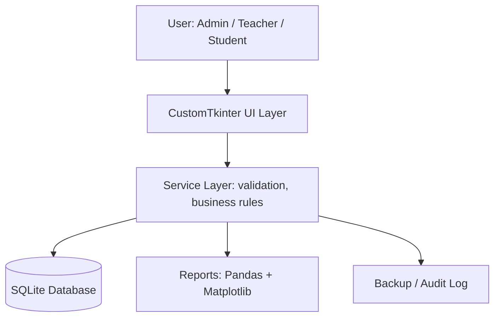
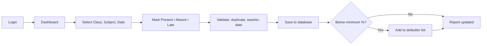

# Product Requirements Document: Attendance Management System

Course: BBAT104 Fundamentals of TQM, Course Project 2026-27
Institute: Amrapali Institute of Technology & Sciences, Haldwani
Baseline system: Attendance Management System (Roll No. ending in 0)
Core TQM goal: Automate tracking and minimize proxy entries
Version: 1.0

## 1. Overview

The Attendance Management System (AMS) is a Python desktop application that replaces paper registers with a digital process for marking, storing, correcting, and reporting student attendance. It is built using TQM principles: customer focus, error prevention (Poka-Yoke), fact-based decisions, and continuous improvement (PDCA).

## 2. Problem Statement

Manual attendance is slow, error-prone, and easy to fake (proxy entries). Teachers lose class time, wrong entries go unnoticed, and month-end percentage calculation is tedious. Students cannot see their status, and the admin cannot quickly find defaulters.

## 3. Quality Objectives

| Quality goal | Measure | Target |
|---|---|---|
| Accuracy | Wrong or duplicate entries | Less than 1% |
| Proxy prevention | Entries marked outside class window or by non-assigned teacher | 0 |
| Speed | Time to mark one class | Under 2 minutes |
| Report time | Time to generate any report | Under 5 seconds |
| Reliability | Data loss after crash | 0 records |
| Traceability | Attendance edits with audit log | 100% |

CTQ parameters: correct attendance data, proxy-resistant marking, fast reports, safe data storage.

Assigned Quality Goal (from roll number): Q__ - ______________ (5 features to be implemented: 1. ____ 2. ____ 3. ____ 4. ____ 5. ____)

## 4. Scope

In scope: login with roles, student/teacher/subject management, attendance marking, correction with audit log, leave requests, reports and charts, defaulter list, backup.

Out of scope: biometric hardware, mobile app, online or cloud deployment.

## 5. User Roles

| Role | What they do |
|---|---|
| Admin | Manages users, courses, subjects; assigns teachers; views all reports; sets minimum attendance percentage; takes backup |
| Teacher | Marks and edits attendance for assigned subjects; approves leave; views class reports |
| Student | Views own attendance and percentage; applies for leave |

## 6. Modules and Features

1. Authentication: login with ID and password; one-time Account Activation for teachers and students using ID and date of birth, then setting a password; role-based access; admin can reset an account.
2. Master Data: CRUD for students, teachers, courses, subjects; bulk import from CSV or Excel; seed script for starting data.
3. Subject Assignment: map teachers to subjects and sections (one teacher can have many subjects).
4. Attendance Marking: choose class, subject, date; mark Present, Absent, Late; mark all present.
5. Proxy Control: one entry per student per subject per date, marking allowed only for the assigned teacher and within the class day, every change logged.
6. Correction with Audit Log: edit with reason; old and new values saved.
7. Leave Management: apply, approve, reject.
8. Reports and Charts: student-wise, subject-wise, monthly percentage; export to CSV; Matplotlib charts.
9. Defaulter Alerts: list of students below the minimum percentage.
10. Backup: one-click database backup.

## 7. Functional Requirements (summary)

- FR1: Authenticate users by ID and password; teachers and students activate their account once using ID and date of birth and then set a password. Restrict screens by role.
- FR2: Admin performs CRUD on students, teachers, courses, and subjects.
- FR3: Block duplicate attendance for the same student, subject, and date.
- FR4: Allow marking only by the assigned teacher.
- FR5: Auto-calculate attendance percentage.
- FR6: Log every attendance edit with user, time, old value, new value, reason.
- FR7: Students see only their own records.
- FR8: Flag students below the minimum percentage.
- FR9: Export reports to CSV.

Full details are in the SRS.

## 8. Non-Functional Requirements

- Performance: screens open in under 2 seconds, reports in under 5 seconds.
- Security: hashed passwords, role checks, parameterized SQL queries.
- Usability: simple layout, dropdowns and date pickers, friendly error messages.
- Reliability: backup option, safe handling of database errors.
- Maintainability: modular code structure with comments.

## 9. Tech Stack

- Language: Python 3.x
- GUI: Tkinter / CustomTkinter
- Database: SQLite3
- Data and reports: Pandas
- Charts (Pareto, Fishbone, attendance graphs): Matplotlib / Seaborn
- Tools: Visual Studio Code, GitHub, GitHub Desktop

## 10. System Architecture and Workflow



Main workflow:



Screens: Login, Dashboard, Students, Teachers, Subjects, Mark Attendance, Edit Attendance, Leave Requests, Reports, Defaulter List, Backup.

## 11. Database Design

| Table | Key fields |
|---|---|
| users | id, login_id, role, dob, password_hash (empty until activation), is_active |
| students | id, user_id, roll_no, name, course_id, semester, section, email |
| teachers | id, user_id, emp_id, name, department, email |
| courses | id, name, duration |
| subjects | id, code, name, course_id, semester |
| teaching_assignments | id, teacher_id, subject_id, course_id, semester, section |
| attendance | id, student_id, subject_id, date, status (Present/Absent/Late/Leave), marked_by |
| leave_requests | id, student_id, from_date, to_date, reason, status, approved_by |
| attendance_logs | id, attendance_id, old_status, new_status, changed_by, changed_at, reason |
| settings | key, value (for example min_attendance = 75) |

Constraint: UNIQUE (student_id, subject_id, date) on attendance.

## 12. Modular Folder Architecture

```
BBAT104_TQM_[RegNo]/
  main.py
  config.py
  database/      (db.py, schema.sql, ams.db)
  models/        (student.py, teacher.py, subject.py, attendance.py)
  services/      (auth_service.py, attendance_service.py, report_service.py)
  ui/            (login_view.py, dashboard_view.py, attendance_view.py, ...)
  utils/         (validators.py, backup.py, logger.py)
  reports/       (sqc_charts.py, exports/)
  tests/
  docs/          (SRS, SIPOC, FMEA, Pareto, Fishbone, PDCA)
  README.md
```

## 13. Course Deliverables Plan

| Milestone | Marks | What will be ready |
|---|---|---|
| Review 1: Setup and SRS | 10 | GitHub repo BBAT104_TQM_[RegNo], README, architecture flowchart, SRS, scope |
| Review 2: Base System and CRUD | 15 | Working CRUD modules, attendance marking, 5 assigned quality-goal features |
| Review 3: FMEA and Risk Audit | 15 | FMEA with RPN, SIPOC, CTQ tree, defect log |
| Review 4: SQC and Improvement | 15 | Pareto chart, Fishbone diagram, checksheets, PDCA log |
| Final Demo and Viva | 10 | Live demo, bug handling, TQM tool defense |
| Documentation and GitHub | 5 | README, user manual, at least 30 commits, GitHub Issues |

## 14. Risks

| Risk | Mitigation |
|---|---|
| Proxy or wrong entries | Unique constraint, teacher check, audit log |
| Data loss | Backup feature |
| App crash on bad input | Strict validation and exception handling |
| Time shortage | Build CRUD first, then quality-goal features |

## 15. Future Scope

QR-based attendance, web or mobile version, SMS alerts, face recognition.
